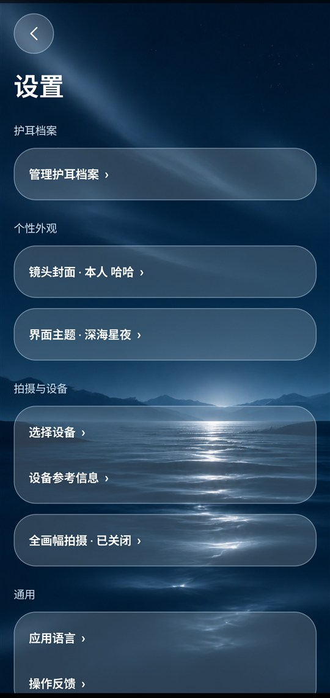

# 微镜记 · Scope Notes

连接 Wi-Fi 可视耳镜的 Android 预览与影像记录工具。支持实时预览、拍照、无声录像、分人档案、年月与耳侧筛选，以及照片标注副本。

当前版本 **v0.27**：[下载 Release](https://github.com/foreverfine77/scope-notes-android/releases/tag/v0.27)。附件提供 Android 安装包、离线 UI 交接包及 SHA-256 校验文件。

本版包含深海星夜等四种主题、个人镜头封面、护耳档案拖动排序、照片跟手切换与回弹，以及 30 秒设备快速检查。连接耳镜后，在封面圆内滑动开始或收起取景。设置页与相册使用同一固定背景，玻璃控件随内容滚动。

剩余分钟数为校准后的估算，界面保留「约」。设备检查记录实际接收数据，并由使用者确认清晰度和补光，不将收到数据等同于排除所有硬件故障。[本轮真机验收范围](android-preview/tests/DEVICE_QA_0.27.md)与[当前全量提示语](提示语审核.md)可供核对。

- [项目历史](HISTORY.md)区分了样机实测、导入时的实现状态和后续计划。
- [UI 设计规范](UI规范.md)统一图标、固定布局、交互状态和验收要求。
- [UI 骨架与逐项审核台](ui-handoff/index.html)用于审核布局、按钮和全部文案，并向 Claude 交接主题设计。[交付说明](ui-handoff/交付说明.md)包含回交接口和检查方法。
- [硬件简报](硬件简报.md)记录样机能力、通信方式和待验证命令。
- [电量观察记录](电量观察记录.md)保存待补充的剩余电量和分钟数读数。
- [Issues](https://github.com/foreverfine77/scope-notes-android/issues)记录任务、验收条件和测试证据。[Projects](https://github.com/users/foreverfine77/projects/3)跟踪任务进度。

## 界面截图

左起为青色取景首页、橙色取景首页和深海星夜设置页。

<p>
  
  
  
</p>

## 构建与试用

在仓库根目录使用 PowerShell，准备 JDK 17、Android SDK 的 `android.jar`、Build Tools 和 ADB。将下面的路径替换为本机路径。

```powershell
.\android-preview\build.ps1 -Jdk 'C:\path\to\jdk-17' -AndroidJar 'C:\path\to\android.jar' -BuildTools 'C:\path\to\build-tools'
.\android-preview\install-preview.cmd
```

构建生成 `android-preview/earclean-preview.apk`。手机开启 USB 调试并授权后可安装。电脑接入耳镜热点后，可运行 `python earclean_probe.py` 验证是否能收到 JPEG 帧。

Git 源码树保存源码、构建脚本、设计稿和项目文档。自制安装包与 UI 交接包通过 Release 附件分发。原厂 APK、本地工具链、签名文件及样机抓图和原始日志留在本地。提交测试证据时使用可公开于项目成员的样本，避免上传个人耳部影像。
